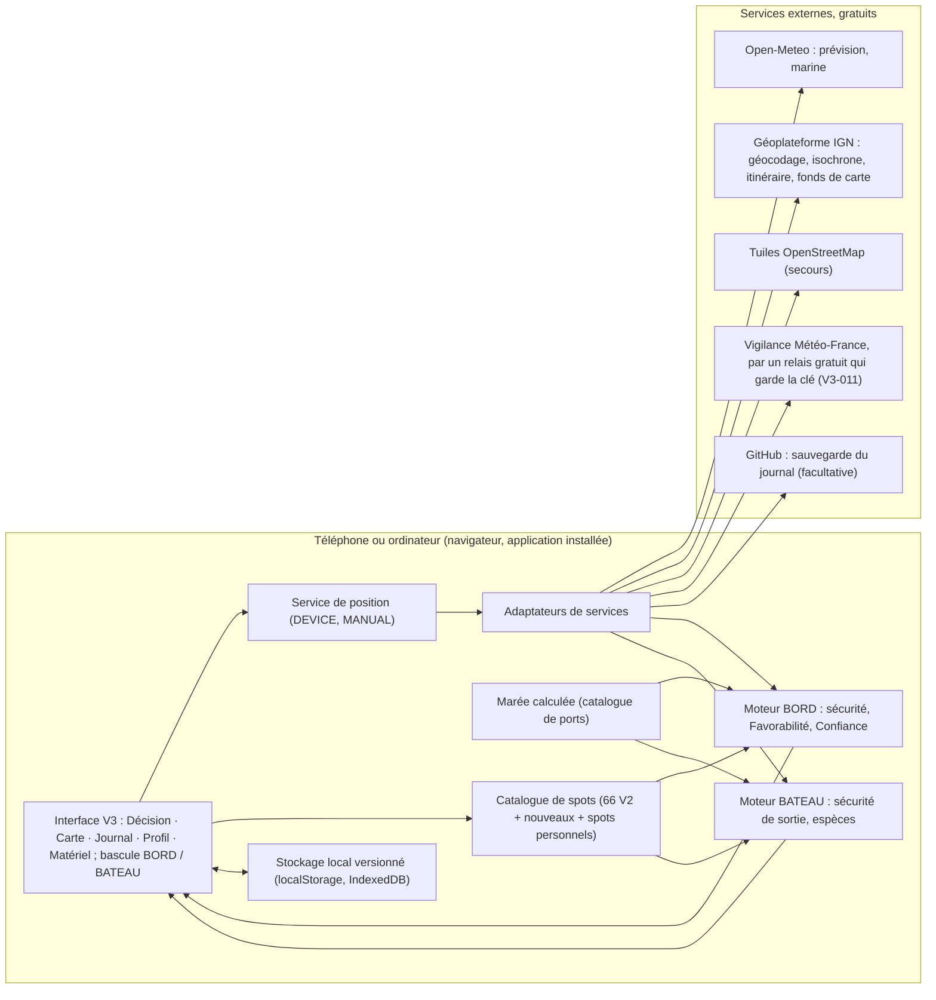

# Architecture cible — SPUMY V3

Phase 2 V3, 20 novembre 2026 ; complétée en phase 4 (23 nov. 2026, § 11). Statut : **VALIDÉE** (ADR-V3-008 à V3-013, V3-018 et V3-020 validées par le jeton de phase 3 ; § 11 à valider avec le rapport de phase 4). `docs/ARCHITECTURE.md` décrit l'architecture réellement en place (V2) ; il sera mis à jour lot par lot, à mesure que cette cible est réalisée.

**En bref** : une seule application statique à deux modes. Un catalogue unique de spots est classé depuis une position de référence. Les moteurs V2 sont gardés sans la Pertinence, et chaque service externe passe par un adaptateur. Pas de serveur à soi, sauf un petit relais gratuit pour la vigilance (V3-011) ; pas de compte ; coût nul (ADR-V3-005).

## 1. Vue d'ensemble



La seule différence de nature avec la V2 est le classement. La V2 classe à l'intérieur d'un guide, depuis son pôle ; la V3 classe depuis une position quelconque, sur le catalogue entier, avec un temps de route réel en BORD.

## 2. Composants et responsabilités

| Composant | Rôle | Point de départ dans la V2 | Changement |
| --- | --- | --- | --- |
| Point d'entrée unique (`index.html` + `app.js`) | une seule page ; routes par ancre (`#decision`, `#carte`, `#spot=<id>`…) | `src/app/entry.jsx`, `home.jsx`, sept pages de guide | les pages de guide deviennent des redirections (`docs/MIGRATION-V3.md`) |
| Service de position | méthodes DEVICE et MANUAL, états, validité, libellé | `MySpotForm.jsx` (GPS, carte, coordonnées collées), « les plus proches de moi » | nouveau module commun `src/core/position/` |
| Catalogue de spots | spots V2, nouveaux spots, spots personnels ; index spatial ; chargement des seuls spots proches | `data/sites/*.config.js`, index de l'accueil | données migrées vers un catalogue (`data/spots/`) ; les champs de guide deviennent `legacy` |
| Catalogue de ports de marée | ports de référence (TICON-4) et ports secondaires ; port le plus proche avec sa précision | `tide.js`, blocs `tide` de chaque fiche | un seul catalogue ; la règle d'interpolation devient une donnée |
| Moteur BORD | sécurité ; Favorabilité ; Confiance ; classement V3 (§ 9.1.6) | `src/bord/engine/v2.js`, `safety.js`, `model.js` (fenêtres) | Pertinence retirée ; classement depuis la position ; Top 3 et égalités (REC-05) ; refonte biologique en Phases 5 à 8 |
| Moteur BATEAU | spots personnels, conditions, sorties, modèle appris ; sécurité de sortie et espèces (V3-014) | `src/bateau/`, branche de la phase 13 | selon V3-014 ; Pertinence retirée |
| Adaptateurs | un par service : requête, normalisation (§ 8.2), cache, erreurs, attribution | `wxcore.js`, `weather.js`, `bateau/wx.js`, `ghsync.js` | nouveaux : géocodage, isochrone, itinéraire, fond de carte, vigilance |
| Stockage | journal, spots personnels, profil, préférences, caches ; schéma versionné, migrations | `storage.js`, `persist.js`, `idb.js`, `merge.js` | clés `bar:*` par guide fusionnées en clés V3 (migration testée) |
| Interface | écrans V3, Design System V3 | `src/bord/ui`, `src/design`, prototype de la phase 11 | refonte en Phase 3 |

Les couches restent celles de la V2 (`tests/layers.mjs`) : `design`, `core`, `bord`, `bateau`, `app`. On ajoute le service de position et les adaptateurs dans `core`, puisqu'ils sont communs aux deux modes.

## 3. Contrats de données

Contrats typés en JSDoc, vérifiés par `tsc --checkJs` (ADR-V3-020). Unités canoniques et heures en UTC (§ 8.2).

```
Position     { lat, lon, precisionM, source: "DEVICE"|"MANUAL", at, validUntil, permission: "granted"|"denied"|"prompt"|"unavailable", explicit, label }
Qualified<T> { value: T|null, unit, source, at, ageMin, resolution, type: "mesurée"|"prévision"|"calculée"|"fournie_utilisateur"|"estimation"|"inconnue" }
Spot         { id, name, mode: "BORD"|"BATEAU", position {lat, lon, precision: "décimales"|"minute"}, access?: {lat, lon, kind},
               habitat, exposure, tide {portId, rules}, safety {dangerLevel, coefHardMax?, houleMax, notes}, sources[], evidence[],
               private: boolean, legacy?: {guide, zone, isLocal, distMin} }
Route        { spotId, minutes|null, source: "IGN"|"estimation", verified: boolean, at, validUntil, originRounded }
Safety       { status: "ok"|"verify"|"nr", rules: [{id, status, reason, at}], worstAt }
Favorability { value: 0..100|null, band: 1..5|null, coverage: 0..1, parts: [...], window {start, end}|null, reasonIfNull }
Confidence   { value: 0..100, level: "haute"|"moyenne"|"faible", dimensions: [...], displayPrecision: "exact"|"range"|"none" }
Ranked       { spot, route, safety, favorability, confidence, rank, group: "sure"|"verify"|"excluded", tieWith: [ids], reasonOfRank }
JournalEntry { id, mode, spotId|zone, start, end, outcome: "capture"|"sans_capture"|"resultat_inconnu"|"incomplete"|"annulee"|"absence_saisie",
               catches[], conditions {planned, observed}, lures[], notes, completeness, updatedAt }
```

Les champs V2 dépréciés (`v2.pert`, `V2.pert`, `bar:boite-complete`, `bar:trajet-max`) sont lus une fois, pendant la migration, puis ignorés (REC-02).

## 4. Position, puis spots atteignables (BORD)

1. **Position** : l'utilisateur choisit « Me géolocaliser » ou « Saisir une position » (géocodage IGN, suggestions, épingle). On garde la précision et la source.
2. **Isochrone** : un appel IGN, voiture, 60 min, depuis la position arrondie à 100 m. Le polygone est gardé en cache 24 h par position arrondie.
3. **Filtre** : un spot est admissible si son accès est dans le polygone, avec la mention « temps vérifié par l'IGN ».
    - **Point ouvert (red-team de la phase 2)** : l'isochrone suit le réseau routier. Un poste sur une pointe, loin de la route, peut tomber hors du polygone alors que son stationnement y est. Le test d'appartenance se fait donc sur le point d'accès (RTE-04). Tant qu'il manque, il se fait sur le point routier le plus proche, donné par l'itinéraire.
    - **Étalonnage** sur les 66 spots, en comparant isochrone et itinéraire, **après la phase 5** (points d'accès audités) et avec l'adaptateur IGN, par un passage de CI qui atteint l'IGN (décision de Félix, 23 nov. 2026, 14 h 54 ; prévu d'abord en phase 4). Aucun spot n'est écarté sur le seul polygone sans ce contrôle.
4. **Temps exact** : un appel « itinéraire » pour chaque spot montré (Top 3 à 5, fiche ouverte), au rythme de 5 appels par seconde au plus ; gardé en cache 24 h.
5. **Dégradé** :
    - hors ligne ou service en échec : estimation par la distance à vol d'oiseau × 1,4, sur 60 km/h, pour lister des spots plausibles ;
    - ces spots sont marqués « temps estimé, non vérifié » et jamais présentés comme « à 60 min ».

   Le coefficient de 1,4 est une HYPOTHÈSE à étalonner sur les temps IGN des 66 spots (même étalonnage, après la phase 5).
6. **Changement de position** : nouvelle isochrone, puis tout est recalculé (POS-06).

En BATEAU, aucun appel routier (RTE-03). Le temps de navigation n'est calculé que si V3-014 le retient, et seulement avec les données du bateau.

## 5. Services, cache et repli

| Service | Cache | Validité | Si le service échoue |
| --- | --- | --- | --- |
| Prévision Open-Meteo, par point | appareil, par spot | 1 h ; âge toujours affiché | données « inconnues » ; sécurité « à vérifier » ; marée et lumière restent (comportement V2) |
| Marine Open-Meteo | idem | 1 h | houle inconnue ; spot engagé « non recommandé », autre spot « à vérifier » (V2) |
| Géocodage IGN | aucun (saisie) | — | coordonnées collées et épingle restent possibles |
| Isochrone IGN | par position arrondie à 100 m | 24 h | mode dégradé (section 4) |
| Itinéraire IGN | par couple (position arrondie, spot) | 24 h | « temps estimé » |
| Fond de carte IGN | cache HTTP du navigateur seulement | — | OpenStreetMap ; hors ligne, « carte indisponible hors ligne » |
| Vigilance (par le relais, V3-011) | par département, 1 h | 1 h | « vigilance inconnue », jamais « aucune » ; rappel et lien |

**Contrôle des services en continu.** Le contrat Open-Meteo réel tourne chaque jour sur GitHub (V2). Le contrat IGN (`.github/workflows/contrat-ign.yml`, phase 4) vérifie chaque jour le géocodage, l'itinéraire, l'isochrone et leur appel par un navigateur depuis l'origine du site publié (CORS). C'est la seule surveillance possible sans serveur. Premier passage : 8/8, CORS ouvert (`Access-Control-Allow-Origin: *`) ; passage 45210735483 du contrat IGN, 23 nov. 2026.

## 6. Hors ligne et synchronisation

- L'application elle-même et le catalogue sont en cache par le service worker, versionné (V2).
- **États affichés** (§ 8.5) :
    - disponible hors ligne ;
    - obsolète (âge au-delà de la validité) ;
    - connexion requise (position saisie, temps vérifié, carte) ;
    - synchronisé, en attente ou en échec (sauvegarde GitHub).
- **Sauvegarde GitHub** facultative et fusion sans perte (`merge.js`, V2). Pas d'écrasement silencieux : une entrée modifiée sur deux appareils garde la plus récente et conserve l'autre en historique. Règle à tester en Phase 13.

## 7. Performance

La V2 publie un `app.js` de 1,04 Mo (346 Ko compressé). La V3 vise un premier affichage utile sur téléphone moyen en 4G, avec un chargement qui ne croît pas avec le nombre de spots :
- catalogue découpé en fichiers par tuile géographique (environ 50 km), chargés selon la position ;
- moteurs et carte chargés à la demande.

Les budgets chiffrés seront fixés en Phase 4, après mesure AVANT (QA-01) : temps du premier affichage, temps du classement, poids par écran, mémoire.

## 8. Sécurité et confidentialité

Le modèle de menace est dans `docs/security/THREAT_MODEL.md`. En résumé :
- site statique ;
- CSP stricte, étendue aux seuls hôtes `data.geopf.fr` et au relais de vigilance ;
- aucun secret ;
- jetons de l'utilisateur sur l'appareil ;
- position de l'utilisateur jamais stockée hors du cache arrondi ;
- spots personnels privés.

## 9. Dépendances par mode

| Service | BORD | BATEAU | Commun |
| --- | --- | --- | --- |
| Position (DEVICE, MANUAL), géocodage | oui | oui | oui |
| Isochrone et itinéraire IGN | oui | non | — |
| Open-Meteo prévision | oui | oui | adaptateur commun, variables propres à chaque mode |
| Open-Meteo marine | oui | oui | idem |
| Marée calculée | oui | oui | catalogue de ports commun |
| Fond de carte | oui | oui | oui |
| Vigilance Météo-France | oui | oui | oui |
| BMS (bulletins marine) | non | oui | — |
| Journal, sauvegarde | oui | oui | stockage commun, entrées typées par mode |

## 10. Options comparées

Voir ADR-V3-008 (forme de l'application), V3-009 (routage), V3-012 (fond de carte) et V3-013 (stockage) dans `docs/DECISIONS_LOG.md`. L'option retenue garde React 18, esbuild et Leaflet, déjà en place et testés. Aucune nouvelle dépendance n'est nécessaire pour la position ni pour le routage : ce sont des appels HTTP par les adaptateurs.

## 11. Architecture détaillée (phase 4)

Mesures de départ : `docs/socle/AUDIT-SOCLE.md`. Règle : pas d'abstraction avant son usage (§ 10.1). La phase 4 pose les fondations communes ; chaque module métier arrive avec la phase qui l'utilise.

### 11.1 Arborescence

| Dossier | Contenu | Phase |
| --- | --- | --- |
| `src/core/contracts/` | **types JSDoc des contrats** du § 3 (Position, Qualified, Spot, Route, Safety, Favorability, Confidence, Ranked, JournalEntry), vérifiés par `tsc --checkJs` | **4** |
| `src/core/errors.js` | **erreur commune** `SpumyError` : code stable, message en français pour la personne, cause gardée, données de diagnostic sans donnée personnelle | **4** |
| `src/core/validate.js` | **validation des entrées aux frontières** (coordonnées, heures, coefficients, nombres bornés), qui renvoie un résultat ou une `SpumyError` | **4** |
| `src/core/position/` | service de position (DEVICE, MANUAL), états, validité | 9 à 12 |
| `src/core/adapters/` | un adaptateur par service (Open-Meteo, IGN géocodage, isochrone, itinéraire, fonds, vigilance) : requête, normalisation, cache, erreurs, attribution | 9 à 12 |
| `data/spots/` | catalogue unique des spots (V3-018 : identifiants V2 gardés) | 5 à 7 |
| `src/bord/engine/` | moteur BORD v2 sans la Pertinence (V3-006) | 6 à 11 |
| `src/bateau/` | moteur BATEAU (V3-014) | 9 à 12 |
| `src/app/` | coquille V3 : entrée unique, routes par ancre, interface du Design System V3 | 12 |

Les couches de `tests/layers.mjs` ne changent pas : `contracts`, `errors` et `validate` sont dans `core`, utilisables par `bord`, `bateau` et `app`, et par le prototype V3 seulement pour ses types (aucun moteur).

### 11.2 Frontières

| Zone | Contenu | Règle |
| --- | --- | --- |
| Parcours V3 | `src/app` (à venir), `src/design/v3`, prototype V3 | n'importe un moteur que par les contrats du § 3 |
| Services communs | `src/core` (marée, soleil, stockage, synchronisation, puis position et adaptateurs) | sans interface ni métier de mode ; erreurs en `SpumyError` |
| Héritage V2 | sept pages de guide, `src/bord/ui`, `prototype/`, fichiers publiés à la racine | inchangés jusqu'à la migration (`docs/MIGRATION-V3.md`) ; le contrôle « site publié = sources » les protège |

### 11.3 Flux d'une recommandation BORD

1. Position (DEVICE ou MANUAL) → `validate.position` → `Position`.
2. Isochrone IGN (position arrondie à 100 m, cache 24 h) → spots admissibles du catalogue ; sinon estimation dégradée, marquée.
3. Pour chaque spot : marée calculée, prévision et mer Open-Meteo (`Qualified<T>` : valeur, unité, source, heure, âge, type).
4. Moteur BORD : sécurité (jamais compensée), puis Favorabilité = conditions × présence, puis Confiance (sans effet sur le rang).
5. Classement V3 (§ 9.1.6, V3-016) → `Ranked[]` → interface.
Chaque étape renvoie une valeur ou une `SpumyError` ; une donnée inconnue reste « inconnue », jamais « au vert ».

### 11.4 Modèle d'erreurs

`SpumyError` porte :
- `code` stable, par famille : `POSITION_*`, `RESEAU_*`, `SERVICE_*`, `DONNEE_*`, `STOCKAGE_*`, `VALIDATION_*` ;
- `message` pour la personne, en français et sans jargon ;
- `cause`, l'erreur d'origine ;
- `details`, pour le diagnostic, sans coordonnées précises, jeton ni contenu du journal.

Règles :
- aucune erreur avalée sans trace (`catch` vide interdit hors des accès au stockage du navigateur, documentés) ;
- une erreur de service dégrade l'affichage (« inconnue », « à vérifier », « temps estimé »), elle ne bloque jamais l'écran ;
- les messages pour la personne disent quoi faire.

### 11.5 Budgets de performance

Mesure AVANT du 23 nov. 2026 (`scripts/mesure-perf.mjs`, `docs/socle/perf-avant.json`). Conditions : Chromium, processeur ralenti 4 fois, 1,6 Mbit/s, 150 ms d'aller-retour, réponses en gzip, cache vide ; médiane de 3 passages.

| Page | Premier affichage | Plus grand affichage | Transfert compressé |
| --- | --- | --- | --- |
| Accueil V2 (en ligne) | 0,33 s | 1,74 s | 779 Ko |
| Guide de Pirou V2 (en ligne) | 0,21 s | 3,13 s | 400 Ko |
| Home du prototype V3 | 1,36 s | 2,82 s | 900 Ko |
| Carte du prototype V3 | 1,31 s | 1,31 s | 212 Ko |

Budgets de l'application V3 (mêmes conditions, vérifiés à chaque phase d'intégration) :

| Mesure | Budget | Raison |
| --- | --- | --- |
| Premier affichage | ≤ 1,5 s | la carte du prototype est à 1,3 s |
| Plus grand affichage | ≤ 2,5 s | seuil « bon » des Web Vitals ; Home et guide sont au-dessus aujourd'hui (photos en 1 600 px sur téléphone) |
| Transfert du premier écran | ≤ 500 Ko compressés, polices comprises (CR-14) | images en 720 px sur téléphone ; moteurs et carte chargés à la demande |
| Classement du jour (moteur) | à mesurer dans l'application intégrée (phase 10) | sans mesure, aucun chiffre n'est revendiqué |

La mémoire JavaScript lue par Chromium est arrondie (9,5 Mo partout) : elle n'est pas retenue comme mesure.

### 11.6 Observabilité d'un site statique

- Aucune télémétrie ni journal distant (confidentialité par défaut).
- Surveillance : la CI (tests à chaque proposition) et le contrat Open-Meteo réel, chaque jour ; un contrat IGN s'y ajoute avec les adaptateurs (§ 5).
- Sur l'appareil : écran d'erreur qui garde le journal exportable (V2) ; âge de chaque donnée affiché.

### 11.7 Environnements

| Environnement | Où | Données |
| --- | --- | --- |
| Développement | poste local ou session Claude : `npm ci`, `npm run build`, `npm test` | démonstration, fixtures |
| Revue | pages de revue privées (artefacts) et propositions en brouillon | démonstration, marquées « démo » |
| Production | GitHub Pages depuis `main` ; fusion = publication, protégée (`docs/socle/PROTECTION-MAIN.md`) | réelles |

Aucun secret côté serveur. La clé de la vigilance Météo-France vivra dans le relais (V3-011), hors du dépôt.

