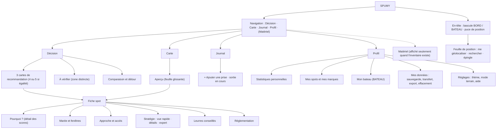

# Fondation UX V3 — usages, architecture de l'information, parcours

Phase 3 V3, 20 novembre 2026. Statut : **PROPOSITION**, à valider par Félix (jalon 1 : besoins, architecture de l'information, parcours) avant la haute fidélité. Exigences visées : POS, RTE, REC, SEC, MAP, SPOT, JRN, PRO, BAT, UX (`docs/REQUIREMENTS.md`). Écarts AVANT : A01 à A22 (`docs/design/AUDIT-UX-AVANT.md`).

## 1. Usages et tâches prioritaires

Repris de la découverte produit (`docs/design/DISCOVERY.md`, H1 à H10). Tout ce qui ne vient pas de Félix est une HYPOTHÈSE.

| Priorité | Tâche | Mode | Fréquence (hypothèse) |
| --- | --- | --- | --- |
| 1 | Savoir où et quand pêcher aujourd'hui ou demain, depuis l'endroit où je suis | BORD | à chaque sortie |
| 2 | Savoir si je peux sortir en mer, où et pour quelles espèces | BATEAU | à chaque sortie en mer |
| 3 | Vérifier un spot avant de partir : danger, accès, marée, approche, leurres | BORD | à chaque sortie |
| 4 | Changer de point de départ (vacances, autre maison) | les deux | plusieurs fois par mois |
| 5 | Noter une sortie et ses prises, vite, sur place ou au retour | les deux | après chaque sortie |
| 6 | Comparer deux spots, et savoir si un détour vaut la peine | BORD | parfois |
| 7 | Revoir mes sorties et mes statistiques | les deux | rarement |
| 8 | Gérer mes spots et mes marques privés | les deux | rarement |

## 2. Scénarios

**BORD**
- **S1, depuis la maison, ce matin.**
    1. J'ouvre l'application : la position est celle de mon appareil (ou la dernière choisie, signalée comme telle).
    2. Décision montre la fenêtre et 3 spots à moins d'une heure, chacun avec sa Favorabilité, sa Confiance, sa sécurité et sa fenêtre.
    3. J'ouvre le premier, je lis l'approche et les leurres conseillés, j'y vais.
- **S2, en vacances.** Je saisis « Crozon » : la carte se recentre, la liste se recalcule, avec les temps de route depuis Crozon. Rien à choisir dans une liste de guides.
- **S3, comparer.** Le n° 1 est à 50 min, le n° 3 à 12 min. La comparaison me dit « +38 min de route pour +6 points de Favorabilité », ou « avantage non établi », avec les raisons.
- **S4, un spot engagé.** La fiche me montre le danger avant tout (raz, accès coupé par la marée), puis la meilleure fenêtre.
- **S5, au bord de l'eau, sans réseau.**
    - L'application montre ce qu'elle a en cache, avec son âge : marée et lumière calculées, météo d'il y a 3 h.
    - Le temps de route devient « estimation ».
    - La carte dit qu'elle a besoin du réseau.
- **S6, noter une sortie.** « + Ajouter une prise » depuis le Journal (ou à la fin de la sortie en cours) : photo ou saisie rapide, complétée plus tard. Une sortie sans prise se note en 3 gestes.

**BATEAU**
- **B1, je sors ou pas ?**
    1. Sans profil du bateau, l'application me demande d'abord de le décrire, une fois.
    2. Elle juge ensuite la sortie, zone par zone, sur le pire moment du créneau : « Oui, 07:00–12:00 », « À vérifier avant de partir » ou « Non : sortie non recommandée », avec les raisons.
- **B2, où et quelles espèces ?** 3 zones (mes marques) classées, chacune avec les espèces ouvertes, leur Favorabilité et leur Confiance, la réglementation et la technique.
- **B3, ajouter une marque.** Sur la carte BATEAU, par GPS, par appui long ou par coordonnées collées : nom, type de fond, profondeur.
- **B4, noter une sortie.** Comme S6, avec les espèces et les capots.
- **B5, ce que disent mes sorties.** Le modèle appris est présenté « d'après tes sorties », jamais comme une note.

## 3. Architecture de l'information

**Où va chaque fonction V2** (rien n'est perdu ; Gate A) :

| V2 | V3 |
| --- | --- |
| Accueil : 7 guides par département | supprimé ; remplacé par la position et le catalogue unique |
| Accueil : recherche, « les plus proches de moi » | feuille de position (recherche de lieu) et recherche de spot sur la Carte |
| Accueil : carte de tous les spots | Carte |
| Accueil : onglet Offshore | bascule BATEAU, avec les mêmes 4 entrées |
| Guide : Décision | Décision (BORD) |
| Guide : Carte (Top 3 ou les 10, fiche) | Carte et Décision ; fiche spot commune |
| Guide : Journal | Journal (BORD et BATEAU, entrées typées) |
| Guide : Matériel (boîte, conseil de leurres) | « Leurres conseillés » dans la fiche spot ; inventaire dans Matériel (dernier lot) |
| Plus : Marée | fiche spot (marée et fenêtres) ; vue marée du jour dans Décision |
| Plus : Météo | fiche spot (conditions détaillées, provenance, âge) |
| Plus : Saison | Décision (contexte du moment de l'année) et fiche (« Pourquoi ? ») |
| Plus : Règles | fiche spot (règles du lieu) et Profil, Aide (règles complètes) |
| Plus : Photos (analyse d'une photo) | Journal, « + Ajouter une prise » par photo |
| Plus : Réglages (thème, moteur, boîte complète, trajet maximal) | Profil, Réglages : thème et mode terrain ; moteur, boîte complète et trajet maximal **supprimés** (V3-006, V3-015, V3-007) |
| Plus : sauvegarde GitHub, transfert | Profil, Mes données |
| Plus : Changer de guide | supprimé (position) |
| Offshore : spots bateau, conditions 7 jours | Carte BATEAU (marques) ; fiche de zone (conditions) |
| Offshore : sorties et prises | Journal BATEAU |
| Offshore : modèle appris | Profil, statistiques BATEAU (« d'après tes sorties ») |

## 4. Navigation et contexte

- **En-tête permanent** : la bascule BORD / BATEAU, puis la puce de position (libellé du lieu, source, précision).
- **Bascule de mode** : elle garde la position, la date et la Carte au même cadrage. Elle change les règles, les listes, les couleurs de repère et le contenu des onglets, sans mélanger les données (BAT-08).
- **Retour** : chaque onglet garde son état (défilement, filtre, fiche ouverte). Une fiche ouverte depuis la Carte revient à la Carte au même cadrage.
- **Liens profonds** :
    - `#decision`, `#carte`, `#journal`, `#profil` ;
    - `#spot=<id>` ; `#comparer=<id>,<id>` ;
    - `#mode=bateau` ;
    - toute ancre inconnue ramène à `#decision` en corrigeant l'adresse (A13).
- **Anciennes adresses** (`pirou.html#spots`…) : redirection vers `#carte`, avec la position du pôle du guide « proposée, à confirmer » (`docs/MIGRATION-V3.md`).
- **États des entrées** : active (couleur d'accent et libellé gras) ; indisponible (Matériel absent, pas grisé) ; aucune entrée bloquée.
- **Priorités sur petit écran (320 px)** : verdict et fenêtre, puis les 3 cartes (nom, Favorabilité, statut, fenêtre, route), puis le reste. La Confiance garde son libellé, même en version courte.

## 5. Position (POS-01 à POS-07)

**Puce de position**, toujours visible dans l'en-tête : « 📍 Pirou-Plage · appareil · ±30 m », ou « Crozon · saisie ». Un appui ouvre la feuille de position :
1. « Me géolocaliser » ;
2. un champ de recherche (ville, adresse, code postal, lieu, coordonnées), avec suggestions ;
3. la mini-carte avec épingle déplaçable ;
4. les dernières positions, sur l'appareil seulement, effaçables.

| État | Que se passe-t-il | Pourquoi | Que faire |
| --- | --- | --- | --- |
| Aucune position (premier lancement) | Décision et Carte demandent une position ; carte de repli sur le littoral couvert, sans position inventée | rien n'est choisi | « Me géolocaliser » ou « Saisir une position » |
| Permission refusée | message, saisie ouverte | refus du système | saisir une position ; rappel de la marche à suivre pour autoriser |
| Position indisponible | message | pas de signal | réessayer, ou saisir |
| Position imprécise (> 1 km) | puce « ±2 km », temps de route marqués « approximatifs » | précision faible | préciser avec l'épingle |
| Position ancienne (au-delà de sa validité) | puce « il y a 3 h » | dernière position connue | actualiser |
| Hors réseau | puce inchangée ; recherche indisponible | pas de réseau | épingle sur la carte en cache, si elle existe |
| Recherche sans résultat ou en échec | message sous le champ | lieu inconnu, ou service injoignable | reformuler ; coller des coordonnées |
| Aucun spot à 60 min de route | Décision : « Aucun spot BORD à moins d'1 h de route d'ici » | position éloignée de la côte couverte | voir les plus proches au-delà d'1 h (liste à part, marquée) ; changer de position |

## 6. Décision

**BORD**, de haut en bas :
1. **Contexte** : date (aujourd'hui, demain, 7 jours), fenêtre de comparaison, « 60 min de route depuis Pirou-Plage ».
2. **Verdict** en une ligne : « Bonne matinée : 07:30–11:00 » ou « Peu favorable aujourd'hui », avec la vigilance si elle est connue.
3. **Les 3 cartes de recommandation**, empilées sur mobile. Chaque carte montre :
    - le rang ;
    - le nom ;
    - la Favorabilité (« 72/100 », jauge à 6 paliers) ;
    - la Confiance (« 69/100 · Moyenne », plus discrète) ;
    - la sécurité (pastille et mot) ;
    - l'espèce (le bar) ;
    - la fenêtre `HH:MM–HH:MM` ou « Fenêtre non déterminable » et sa raison ;
    - le temps de route (« 24 min » vérifié, ou « ~25 min, estimation ») ;
    - une raison principale (« courant portant sur le platier à mi-marée montante »).

   Actions : ouvrir la fiche ; voir sur la carte.
4. **Égalités** : 4 ou 5 cartes si l'égalité est stricte au dernier rang ; au-delà de 5, « + 3 autres à égalité ». Pas de départage caché.
5. **Place réservée** (V3-016) : si aucun des trois n'est à 15 min ou moins, la 3ᵉ carte va au meilleur spot admissible à 15 min ou moins, étiqueté « Le plus proche ». Jamais un spot « à vérifier » ou bloqué.
6. **Moins de 3 spots admissibles** : seulement les spots disponibles, plus une ligne qui dit pourquoi (« 2 spots seulement : vent de force 7 sur les côtes exposées »). Jamais un spot « à vérifier », dangereux, bloqué, sans données suffisantes ou non recommandé pour combler. Un spot « prudence » n'y figure que si la règle de sécurité validée l'autorise, avec l'avertissement visible sur la carte (§ 6.7.4.1).
7. **À vérifier** : zone distincte et repliée, sous les cartes. « 4 spots à vérifier » avec leur raison ; jamais promus parmi les cartes.
8. **Comparer** : choisir deux spots, ouvrir la comparaison.

**BATEAU** :
1. Sans profil : « Décris ton bateau une fois » (catégorie, armement, abris, vitesse, seul à bord). Aucun verdict avant.
2. **Verdict de sortie** : la sécurité d'abord, sur le pire moment du créneau, avec les raisons et l'heure du pire moment.
3. **3 cartes de zone** (tes marques). Chaque carte montre :
    - le rang et le nom ;
    - la sécurité de la zone ;
    - les espèces ouvertes, chacune avec sa Favorabilité et sa Confiance ;
    - la réglementation qui s'applique ;
    - la distance à l'abri et le temps à la vitesse du bateau, seulement si le profil le permet.

   Mêmes règles d'égalité et de pénurie.
4. **Rappels** : aide à la flottabilité, canal 16, BMS, itinéraire laissé à un proche.

## 7. Carte

- **Mobile** :
    - carte plein écran ; en haut, la puce de position, la recherche et les filtres en puces avec compteur exact (« Tous 42 », « Favorables 6 », « À vérifier 4 », « Mes spots 2 ») ; « Favorables » applique exactement le seuil validé et les conditions de sécurité et de vérification, et ne veut jamais dire « sans danger » (§ 6.7.4). Le seuil V3 (65 en V2, ou une borne de palier) est À DÉCIDER avec le Design System (3.5) ;
    - en bas, une feuille glissante à trois hauteurs : poignée seule ; liste classée ; aperçu du spot choisi ;
    - boutons : recentrer sur ma position de référence ; « Me géolocaliser » ; couches (plan, photo aérienne).
- **Bureau** : liste classée à gauche (environ 400 px), carte à droite ; mêmes filtres.
- **Grammaire des pastilles** :
    - remplissage = palier de Favorabilité (6 paliers, § 6.7.5.1) ;
    - « À vérifier » = contour pointillé et « ? » ;
    - « Non recommandé » = barré ;
    - sans note = vide ;
    - spot personnel = forme carrée ;
    - sélectionné = anneau épais et légère mise à l'échelle.

  La Confiance n'est jamais portée par la pastille.
- **Regroupement** : au-delà de 8 pastilles qui se chevauchent, une bulle avec le nombre. Pas de couleur ni de moyenne. Un appui zoome sur le groupe.
- **Légende** : une ligne de 6 pastilles avec leur borne (« 0–19 · 20–39 · … · 90–100 »), plus 3 signes ; le texte détaillé est derrière « ? ».
- **Diagnostic V2** : les pastilles existent toutes et sont bien placées par rapport aux données. Les défauts sont ailleurs :
    - la taille de la carte (340 px) ;
    - les chevauchements, sans regroupement ;
    - le cadrage sur le pôle du guide ;
    - la précision des 7 spots de Pirou (A08) ;
    - les tuiles, non vérifiables d'ici.

  Ce n'est pas un problème de couche (z-index) : la recette de la carte (§ 6.9, 10 points) s'appliquera à l'intégration.

## 8. Fiche spot

L'ordre suit le principe « voir avant de lire » (§ 6.5.1) :
1. Nom, photo (« Illustration » si ce n'est pas le lieu), temps de route et accès.
2. Bloc des scores : Favorabilité en grand (jauge, palier, libellé) ; Confiance en dessous (« 69/100 — Moyenne · qualité des données et des preuves · ne change pas le rang ») ; statut « À vérifier » ou sécurité, avec ses mots.
    - **Libellé de la Favorabilité** (PROPOSITION) : le mot du palier (Très faible, Faible, Moyen, Bon, Très bon, Excellent, § 6.7.5.1), sauf si un statut s'applique : il prend alors la place du mot (« 53/100 — À vérifier », fixture § 6.7.2). La couleur de la jauge reste celle du palier de la valeur.
    - **Libellé de la Confiance** : Haute, Moyenne ou Faible (§ 6.7.5), qui n'est pas le mot du palier de couleur : 69 est jaune (« Bon » en lecture visuelle) et s'écrit « Moyenne ».
3. **Sécurité et raisons**, jamais repliées si elles changent la décision.
4. Fenêtre du jour, et phases de marée avec l'approche de chacune.
5. **Approche** : texte complet et structuré (départ, cheminement, repères, poste, sens de prospection, variantes selon la marée, précautions). La synthèse vient d'abord, le détail ensuite.
6. **Stratégie** : vue rapide, détails, expert.
7. **Leurres conseillés** : conseil générique, sans inventaire. Une place est réservée à la sélection personnelle, qui viendra avec Matériel.
8. **« Pourquoi ? »** : composantes réellement calculées, couverture, données manquantes, provenance et âge.
9. **Réglementation** du lieu, avec sa source et sa date. **Sources du spot.**

## 9. Comparaison et détour (§ 6.7.5.3)

- Deux à trois colonnes, alignées dans cet ordre : sécurité et vérification ; Favorabilité ; Confiance et fraîcheur des données ; espèce ; fenêtre ; route (km, min) et accès ; réglementation ; raison du rang.
- Le premier spot choisi sert de référence ; l'autre est l'alternative. Le supplément s'affiche en kilomètres et en minutes, avec les facteurs concrets qui expliquent l'écart (« courant portant à 08:10 », « houle plus faible côté est »).
- **Écart** : « +12 min de route pour +18 points de Favorabilité », seulement si les deux spots ont la même fenêtre et des données comparables (fraîcheur, couverture). Sinon : « avantage non établi », avec la raison. Sans temps de route vérifié, le supplément est « estimation » ou absent, jamais inventé.
- La sécurité, la réglementation et l'accès ne se compensent pas : un spot bloqué reste bloqué, quel que soit l'écart.
- Aucun verdict automatique, aucun trophée, aucun seuil de détour avant validation.

## 10. Journal, Profil, export

- **Journal** :
    - liste des sorties, chacune avec son état (prise, sans prise, résultat inconnu, incomplète, annulée) ; un « non renseigné » n'est jamais une bredouille ;
    - « + Ajouter une prise » visible en permanence ;
    - sortie en cours avec un chrono ;
    - ajout par photo (l'analyse V2 reprise), puis complétion plus tard.
- **Profil** : statistiques personnelles, à définir après étude (PRO-02) ; mes spots et mes marques ; mon bateau ; mes données ; réglages ; aide.
- **Export du journal** : l'emplacement n'est **pas décidé** (§ 6.4). Options à tester avec le prototype :
    - (A) Profil, Mes données ;
    - (B) menu du Journal ;
    - (C) les deux, la même action.

  Critère : trouvé sans aide en moins de 20 s par 4 personnes sur 5. La décision viendra après le test.

## 11. États communs (§ 6.11)

Chaque état dit ce qui se passe, pourquoi, et ce qu'on peut faire.

| État | Où | Message type | Action |
| --- | --- | --- | --- |
| Chargement | Décision, Carte | « Calcul des spots autour de Pirou-Plage… » ; squelettes, sans statut provisoire (A12) | — |
| Données absentes | carte de spot | « Houle inconnue : sécurité à vérifier » | voir la source |
| Erreur de service | Décision | « Météo injoignable : marée et lumière seulement » | réessayer |
| Données anciennes | partout | « Météo d'il y a 3 h » | actualiser |
| Hors ligne | partout | bandeau « Hors ligne : données de 06:10 » | — |
| Aucun spot à ≤ 1 h | Décision | voir § 5 | changer de position |
| Action réussie | Journal | « Sortie enregistrée sur cet appareil » | annuler (5 s) |
| Action impossible | Journal | « Photo trop lourde (12 Mo) » | choisir une autre photo |
| Synchronisation en attente ou en échec | Profil, Journal | « 2 sorties à sauvegarder » ; « Échec : jeton refusé » | réessayer ; vérifier le jeton |
| Conflit | Journal | « Cette sortie a été modifiée sur un autre appareil » | garder l'une, l'autre ou les deux |
| Sécurité non documentée | fiche, carte | « Danger non documenté : à vérifier sur place » | — |

## 12. Wireframes basse fidélité

Dans `docs/design/wireframes/` : la source (`index.html`, ouverte telle quelle dans un navigateur) et une capture par écran (`*.webp`, 320 px de large, plus une vue bureau). Gris seulement, données fictives marquées comme telles, aucune couleur de palier : ils valident la structure et la hiérarchie, pas l'apparence (§ 6.3).

| Écran | Fichier | Sections du présent document |
| --- | --- | --- |
| Premier lancement, sans position | `01-premier-lancement.webp` | § 5 |
| Feuille de position | `02-position.webp` | § 5 |
| Décision BORD | `03-decision-bord.webp` | § 6 |
| Décision BORD : pénurie et égalité | `04-decision-bord-cas.webp` | § 6 (points 4 à 7) |
| Carte (mobile) | `05-carte.webp` | § 7 |
| Fiche spot | `06-fiche-spot.webp` | § 8 |
| Comparaison | `07-comparaison.webp` | § 9 |
| BATEAU : profil du bateau | `08-bateau-profil.webp` | § 6 (BATEAU, point 1) |
| Décision BATEAU | `09-decision-bateau.webp` | § 6 (BATEAU) |
| Journal | `10-journal.webp` | § 10 |
| Profil | `11-profil.webp` | § 10 |
| Hors ligne, aucun spot à ≤ 1 h | `12-etats.webp` | § 5, § 11 |
| Carte (bureau) | `13-carte-bureau.webp` | § 7 |

## 13. Jalon 1 : ce que Félix valide

1. Les **tâches prioritaires** (§ 1) et leur ordre.
2. L'**architecture** (§ 3) : 4 entrées (Matériel plus tard), bascule BORD / BATEAU dans l'en-tête, et l'endroit où va chaque fonction V2.
3. Les **parcours** : position (§ 5), Décision (§ 6), Carte (§ 7), fiche (§ 8), comparaison (§ 9), Journal (§ 10).

Restent hors du jalon 1 : l'apparence (jalon 2), le seuil du filtre « Favorables » (3.5), l'emplacement de l'export (test), les statistiques du Profil (étude).
