# Fondation UX V3 — usages, architecture de l'information, parcours

Phase 3 V3, 20 novembre 2026. **Version 2**, après la réponse de Félix au jalon 1 (20 nov., 13 h 46) :
- tâches prioritaires **validées** ;
- architecture et parcours **validés avec remarques**, intégrées ici et marquées « (jalon 1) ».

Le relevé des remarques et leur traitement sont au § 14.

Exigences visées : POS, RTE, REC, SEC, MAP, SPOT, JRN, PRO, BAT, MET, UX (`docs/REQUIREMENTS.md`). Écarts AVANT : A01 à A22 (`docs/design/AUDIT-UX-AVANT.md`).

## 1. Usages et tâches prioritaires (validées)

Repris de la découverte produit (`docs/design/DISCOVERY.md`, H1 à H10). L'ordre est validé par Félix ; les fréquences restent des HYPOTHÈSES.

| Priorité | Tâche | Mode | Fréquence (hypothèse) |
| --- | --- | --- | --- |
| 1 | Savoir où et quand pêcher aujourd'hui ou demain, depuis l'endroit où je suis | BORD | à chaque sortie |
| 2 | Savoir si je peux sortir en mer, où et pour quelles espèces | BATEAU | à chaque sortie en mer |
| 3 | Vérifier un spot avant de partir : danger, accès, marée, approche, leurres | BORD | à chaque sortie |
| 4 | Changer de point de départ (vacances, autre maison) | les deux | plusieurs fois par mois |
| 5 | Noter une sortie et ses prises, vite, sur place ou au retour | les deux | après chaque sortie |
| 6 | Comparer deux spots, et savoir si un détour vaut la peine | BORD | parfois |
| 7 | Revoir mes sorties et mes statistiques | les deux | rarement |
| 8 | Gérer mes spots et mes marques privés | les deux | rarement |

La météo devient une entrée à part entière (jalon 1). Elle sert les tâches 1 et 2 : voir le vent et sa direction autour de soi avant de choisir.

## 2. Scénarios

**BORD**
- **S1, depuis la maison, ce matin.**
    1. J'ouvre l'application : Home montre la photo de fond et, au centre, une phrase qui résume la pêche probable (« Bonne matinée pour le bar : 07:30–11:00, à moins d'1 h d'ici »).
    2. La position vient du téléphone (mode automatique) ou du lieu que j'ai fixé (mode manuel), lisible en haut à droite.
    3. En dessous : 3 spots, chacun avec ses horaires bien visibles, sa Favorabilité, sa Confiance, sa sécurité.
    4. J'ouvre le premier ; la courbe de marée montre les heures favorables en couleur ; je lis l'approche et les leurres conseillés.
- **S2, en vacances.** J'appuie sur la position en haut à droite et je saisis « Crozon », ou je pose l'épingle. Tout se recalcule depuis Crozon. Rien à choisir dans une liste de guides.
- **S3, le vent.** J'ouvre Météo : la carte montre la force et la direction du vent autour de moi, heure par heure. Je vois quelles côtes sont sous le vent.
- **S4, comparer.** Le n° 1 est à 50 min, le n° 3 à 12 min. La comparaison donne le vent sur chacun, l'écart de Favorabilité et le supplément de route, ou « avantage non établi ».
- **S5, un spot engagé.** La fiche montre le danger avant tout (raz, accès coupé par la marée), puis la courbe de marée et ses heures favorables.
- **S6, au bord de l'eau, sans réseau.** L'application montre ce qu'elle a en cache, avec son âge. La marée et la lumière sont calculées sur place. Le temps de route devient « estimation » ; la carte et la météo disent qu'elles ont besoin du réseau.
- **S7, noter une sortie.** « + Noter une sortie » sur Home, ou depuis le Journal : photo ou saisie rapide, complétée plus tard. Une sortie sans prise se note en 3 gestes.

**BATEAU**
- **B1, je sors ou pas ?**
    1. L'application utilise mon bateau enregistré dans Profil, ou me laisse remplir ses caractéristiques pour cette sortie (le bateau d'un ami, par exemple).
    2. Elle juge la sortie sur le pire moment du créneau : « Sortie possible : 07:00–12:00 », « À vérifier avant de partir » ou « Sortie non recommandée », avec les raisons.
- **B2, où et quelles espèces ?** 3 zones (mes marques) classées, chacune avec les espèces ouvertes, leur Favorabilité et leur Confiance, la réglementation et la technique.
- **B3, la mer.** Météo en mode BATEAU : vent et état de la mer (hauteur, période et direction des vagues) sur la carte, heure par heure.
- **B4, ajouter une marque.** Sur la carte BATEAU, par GPS, par appui long ou par coordonnées collées : nom, type de fond, profondeur.
- **B5, noter une sortie.** Comme S7, avec les espèces et les capots.
- **B6, ce que disent mes sorties.** Le modèle appris est présenté « d'après tes sorties », jamais comme une note.

## 3. Architecture de l'information (jalon 1)

```mermaid
flowchart TB
  APP["SPUMY"] --> BAR["En-tête : bascule BORD / BATEAU · puce de position (en haut à droite)"]
  APP --> NAV["Barre défilante : 4 onglets visibles, glisser la barre fait apparaître les autres · ordre par défaut Home · Carte · Météo · Profil · Journal"]
  NAV --> HOME["Home"]
  NAV --> CAR["Carte"]
  NAV --> MET["Météo"]
  NAV --> PRO["Profil"]
  NAV --> JOU["Journal (5ᵉ onglet, visible en faisant défiler la barre ; aussi depuis Home et Profil)"]
  NAV -.-> MAT["Matériel (ajouté à la barre quand l'inventaire existe)"]
  HOME --> PHRASE["Photo de fond · phrase de synthèse"]
  HOME --> CARDS["3 cartes de recommandation (4 ou 5 si égalité)"]
  HOME --> VERIF["À vérifier (zone distincte)"]
  HOME --> CMP["Comparaison et détour"]
  HOME --> QUICK["+ Noter une sortie · sortie en cours"]
  CARDS --> FICHE["Fiche spot"]
  CAR --> PREV["Aperçu (feuille glissante)"] --> FICHE
  MET --> WIND["Carte du vent : force et direction, heure par heure"]
  MET --> SEA["BATEAU : vagues et houle"]
  MET --> DAY["Résumé et courbes du jour, sources et âge"]
  FICHE --> TIDE["Courbe de marée, heures favorables en couleur, indicateurs du jour"]
  FICHE --> WHY["Pourquoi ? (détail des scores)"]
  FICHE --> APPR["Approche et accès"]
  FICHE --> STRAT["Stratégie : vue rapide · détails · expert"]
  FICHE --> LURES["Leurres conseillés"]
  FICHE --> RULES["Réglementation"]
  BAR --> POS["Feuille de position : me géolocaliser · lieu actuel modifiable · épingle"]
  JOU --> ADD["+ Ajouter une prise · sortie en cours"]
  PRO --> JOU2["Journal"]
  PRO --> STATS["Statistiques personnelles"]
  PRO --> MINE["Mes spots et mes marques"]
  PRO --> BOAT["Mes bateaux (BATEAU)"]
  PRO --> DISP["Affichage : ordre des onglets, photo de fond de Home, thème, mode terrain"]
  PRO --> DATA["Mes données : sauvegarde, transfert, export, effacement"]
  PRO --> HELP["Aide et règles"]
```

**Où va chaque fonction V2** (rien n'est perdu ; Gate A) :

| V2 | V3 |
| --- | --- |
| Accueil : 7 guides par département | supprimé ; remplacé par la position et le catalogue unique |
| Accueil : recherche, « les plus proches de moi » | feuille de position (recherche de lieu) et recherche de spot sur la Carte |
| Accueil : carte de tous les spots | Carte |
| Accueil : onglet Offshore | bascule BATEAU, mêmes onglets |
| Guide : Décision | **Home** (BORD) |
| Guide : Carte (Top 3 ou les 10, fiche) | Carte et Home ; fiche spot commune |
| Guide : Journal | Journal (BORD et BATEAU, entrées typées) : onglet au choix, ou depuis Home et Profil |
| Guide : Matériel (boîte, conseil de leurres) | « Leurres conseillés » dans la fiche spot ; inventaire dans Matériel (dernier lot) |
| Plus : Marée | fiche spot (courbe de marée et heures favorables) |
| Plus : Météo | **onglet Météo** (carte du vent, état de la mer, résumé du jour) ; conditions du spot dans sa fiche |
| Plus : Saison | Home (contexte du moment de l'année) et fiche (« Pourquoi ? ») |
| Plus : Règles | fiche spot (règles du lieu) et Profil, Aide (règles complètes) |
| Plus : Photos (analyse d'une photo) | Journal, ajout par photo |
| Plus : Réglages (thème, moteur, boîte complète, trajet maximal) | Profil, Affichage : thème et mode terrain ; moteur, boîte complète et trajet maximal **supprimés** (moteur : V3-015 ; boîte complète : V3-006 ; trajet maximal : V3-007) |
| Plus : sauvegarde GitHub, transfert | Profil, Mes données |
| Plus : Changer de guide | supprimé (position) |
| Offshore : spots bateau, conditions 7 jours | Carte BATEAU (marques) ; Météo BATEAU ; fiche de zone |
| Offshore : sorties et prises | Journal BATEAU |
| Offshore : modèle appris | Profil, statistiques BATEAU (« d'après tes sorties ») |

## 4. Navigation et contexte (jalon 1)

- **En-tête permanent** : la bascule BORD / BATEAU à gauche, la puce de position en haut à droite (lieu, mode automatique ou manuel, précision ou âge).
- **Barre défilante, 4 onglets visibles** (précision de Félix, 20 nov., 14 h 02) :
    - on change d'onglet en **touchant** l'onglet ;
    - on **fait glisser la barre** de droite à gauche ou de gauche à droite : d'autres onglets apparaissent, certains disparaissent ; elle défile par onglet entier (aimantation) ;
    - **ordre par défaut** : Home · Carte · Météo · Profil, puis Journal (et Matériel quand l'inventaire existe), hors champ à droite ;
    - **l'ordre se change dans Profil, Affichage** : les 4 premiers sont ceux qu'on voit sans faire défiler ;
    - un repère montre qu'il y a d'autres onglets : bord en fondu et chevron du côté où la barre peut défiler. L'onglet actif reste toujours visible ; s'il est hors champ, la barre défile pour le montrer ;
    - au clavier, chaque onglet reçoit le focus et la barre défile jusqu'à lui ; avec « mouvement réduit », le défilement n'est pas animé ;
    - le contenu de l'écran ne change pas d'onglet par glissement : les cartes, courbes et curseurs gardent leurs gestes.
- **Journal** : 5ᵉ onglet de la barre, et toujours à un geste depuis Home (« + Noter une sortie », bandeau de la sortie en cours) et depuis Profil.
- **Bascule de mode** : elle garde la position, la date et le cadrage de la carte. Elle change les règles, les listes et le contenu des onglets, sans mélanger les données (BAT-08).
- **Retour** : chaque onglet garde son état (défilement, filtre, heure choisie dans Météo, fiche ouverte). Une fiche ouverte depuis la Carte revient à la Carte au même cadrage.
- **Liens profonds** :
    - `#home`, `#carte`, `#meteo`, `#journal`, `#profil` ;
    - `#spot=<id>` ; `#comparer=<id>,<id>` ; `#mode=bateau` ;
    - toute ancre inconnue ramène à `#home` en corrigeant l'adresse (A13).
- **Anciennes adresses** (`pirou.html#spots`…) : redirection vers `#carte`, avec la position du pôle du guide « proposée, à confirmer » (`docs/MIGRATION-V3.md`).
- **États des onglets** : actif (repère d'accent et libellé gras) ; aucun onglet bloqué.
- **Priorités sur petit écran (320 px)** : phrase et horaires, puis les 3 cartes (nom, horaires, Favorabilité, statut, route), puis le reste. La Confiance garde son libellé, même en version courte.

## 5. Position (POS-01 à POS-07 ; jalon 1)

**Puce de position**, en haut à droite, toujours visible : « Pirou · auto · ±30 m », ou « Crozon · manuel ».

Deux modes, au choix dans la feuille de position :
- **Automatique** : la position vient du téléphone. Au premier lancement, l'application demande l'autorisation du système une seule fois ; elle n'insiste pas en cas de refus.
- **Manuel** : un lieu fixé par l'utilisateur, gardé jusqu'à ce qu'il le change.

Aucun grand bouton au centre de Home (jalon 1).

Un appui sur la puce ouvre la **feuille de position** :
1. « Me géolocaliser » : passe en mode automatique et lit la position du téléphone.
2. **Le lieu actuel**, écrit dans un champ modifiable. Après une géolocalisation, c'est le nom de la commune, retrouvé par géocodage inverse (Géoplateforme : service INFÉRÉ, à vérifier en Phase 4, comme le géocodage direct dont le CORS est INCONNU). On peut effacer et taper une ville, une adresse, un code postal ou des coordonnées. Les propositions n'apparaissent que pendant la frappe, sous le champ, et disparaissent au choix. Si le nom ne peut pas être retrouvé, le champ affiche les coordonnées.
3. **La carte avec épingle** : la déplacer fixe la position manuellement.
4. Les dernières positions, sur l'appareil seulement, effaçables (en petit, sous la carte).

| État | Que se passe-t-il | Pourquoi | Que faire |
| --- | --- | --- | --- |
| Premier lancement | demande d'autorisation du système ; la puce indique « Position… » | mode automatique par défaut | accepter, ou toucher la puce pour saisir un lieu |
| Aucune position (refus ou attente) | puce « Choisir une position » mise en évidence ; Home : phrase « Choisis ta position en haut à droite pour voir où pêcher » ; carte de repli sur le littoral couvert, sans position inventée | rien n'est connu | toucher la puce |
| Permission refusée | puce « Position refusée · manuel » | refus du système | saisir un lieu ou poser l'épingle ; rappel de la marche à suivre pour autoriser |
| Position indisponible | puce « Position indisponible » | pas de signal | réessayer, ou passer en manuel |
| Position imprécise (> 1 km) | puce « ±2 km » ; temps de route marqués « approximatifs » | précision faible | préciser avec l'épingle |
| Position ancienne | puce « il y a 3 h » | dernière position connue | actualiser |
| Hors réseau | puce inchangée ; recherche et nom du lieu indisponibles | pas de réseau | épingle sur la carte en cache, si elle existe |
| Recherche sans résultat ou en échec | message sous le champ | lieu inconnu, ou service injoignable | reformuler ; coller des coordonnées |
| Aucun spot à 60 min de route | Home : « Aucun spot BORD à moins d'1 h de route d'ici » | position éloignée de la côte couverte | voir les plus proches au-delà d'1 h (liste à part, marquée) ; changer de position |

## 6. Home (ex-Décision ; jalon 1)

**BORD**, de haut en bas :
1. **Photo de fond** sous l'en-tête :
    - par défaut, choisie automatiquement selon la lumière, le ciel et la mer du moment (règles V2 reprises) ;
    - Profil, Affichage, permet de fixer une photo du catalogue.
    - Elle est toujours marquée « Illustration ».
2. **Phrase de synthèse**, au centre de la photo, avec un voile pour la lisibilité. Elle résume la pêche probable du jour choisi, horaires compris :
    - « Bonne matinée pour le bar : 07:30–11:00, à moins d'1 h d'ici » ;
    - ou « Peu favorable aujourd'hui : vent de force 7 sur les côtes exposées ».

   Elle ne promet rien (§ 6.6) et suit la vigilance quand elle est connue.
3. **Contexte** : date (aujourd'hui, demain, 7 jours), « 60 min de route depuis Pirou », et une **frise du jour** (00:00–24:00) où les horaires favorables sont colorés, avec le lever et le coucher du soleil.
4. **Les 3 cartes de recommandation**, empilées sur mobile. Chaque carte montre, dans cet ordre :
    - **les horaires en tête**, en grand (« 07:30–11:00 ») ou « Fenêtre non déterminable » et sa raison (jalon 1 : les horaires étaient peu visibles) ;
    - le rang et le nom ;
    - la Favorabilité (« 72/100 — Bon », jauge à 6 paliers) ;
    - la Confiance (« 69/100 — Moyenne », plus discrète) ;
    - la sécurité (pastille et mot) ;
    - l'espèce (le bar) ;
    - le temps de route (« 24 min » vérifié, ou « ~25 min, estimation ») ;
    - une raison principale (« courant portant sur le platier à mi-marée montante »).

   Actions : ouvrir la fiche ; voir sur la carte.
5. **Égalités** : 4 ou 5 cartes si l'égalité est stricte au dernier rang ; au-delà de 5, « + 3 autres à égalité ». Pas de départage caché.
6. **Place réservée** (V3-016) : si aucun des trois n'est à 15 min ou moins, la 3ᵉ carte va au meilleur spot admissible à 15 min ou moins, étiqueté « Le plus proche ». Jamais un spot « à vérifier » ou bloqué.
7. **Moins de 3 spots admissibles** :
    - seulement les spots disponibles, plus une ligne qui dit pourquoi (« 2 spots seulement : vent de force 7 sur les côtes exposées ») ;
    - jamais un spot « à vérifier », dangereux, bloqué, sans données suffisantes ou non recommandé pour combler ;
    - un spot « prudence » n'y figure que si la règle de sécurité validée l'autorise, avec l'avertissement visible sur la carte (§ 6.7.4.1).
8. **À vérifier** : zone distincte et repliée, sous les cartes. « 4 spots à vérifier » avec leur raison ; jamais promus parmi les cartes.
9. **Comparer** : choisir deux spots, ouvrir la comparaison.
10. **+ Noter une sortie**, et le bandeau de la sortie en cours s'il y en a une.

**BATEAU** :
1. **Bateau de la sortie** (jalon 1) :
    - « Mon bateau » enregistré dans Profil, choisi par défaut ;
    - ou « Saisir pour cette sortie » (catégorie, longueur et motorisation, armement, vitesse, seul à bord, port de départ), avec la possibilité de l'enregistrer.
    - Aucun verdict sans l'un ou l'autre.
2. **Photo de fond et phrase de synthèse**, la sécurité d'abord : « Sortie possible : 07:00–12:00 », ou « Sortie non recommandée : rafales de 30 nœuds à 12:40 ». Le verdict est jugé sur le pire moment du créneau, avec les raisons.
3. **3 cartes de zone** (tes marques). Chaque carte montre :
    - les horaires en tête ;
    - le rang et le nom ;
    - la sécurité de la zone ;
    - les espèces ouvertes, chacune avec sa Favorabilité et sa Confiance ;
    - la réglementation qui s'applique ;
    - la distance à l'abri et le temps à la vitesse du bateau, seulement si le profil le permet.

   Mêmes règles d'égalité et de pénurie.
4. **Rappels** : aide à la flottabilité, canal 16, BMS, itinéraire laissé à un proche.
5. **Carte marine** (bonus, pas obligatoire, jalon 1) : couche « épaves, hauts-fonds, balisage » sur la Carte BATEAU. Elle est À ÉTUDIER : sources, licences et conditions d'usage à vérifier avant toute promesse (V3-024). Elle ne remplace jamais une carte marine officielle à jour, et l'application doit le dire.

## 7. Carte

- **Mobile** :
    - carte plein écran ; en haut, la recherche de spot et les filtres en puces avec compteur exact (« Tous 42 », « Favorables 6 », « À vérifier 4 », « Mes spots 2 ») ;
    - « Favorables » applique exactement le seuil validé et les conditions de sécurité et de vérification, et ne veut jamais dire « sans danger » (§ 6.7.4). Seuil : 75, décidé par Félix (V3-021) ;
    - en bas, une feuille glissante à trois hauteurs : poignée seule ; liste classée ; aperçu du spot choisi ;
    - boutons : recentrer sur ma position de référence ; « Me géolocaliser » ; couches (plan, photo aérienne ; carte marine en BATEAU, si elle est retenue).
- **Bureau** : liste classée à gauche (environ 400 px), carte à droite ; mêmes filtres.
- **Grammaire des pastilles** (version 2, après le jalon 2 : « les puces sont vilaines et on n'y comprend rien », « il n'y a pas les scores ») :
    - chaque pastille est une **étiquette** : une pastille de couleur au palier de Favorabilité, puis le **score écrit** (« 82 ») en marine sur blanc cassé ;
    - « À vérifier » : contour ambre et triangle d'avertissement devant le score ;
    - « Non recommandé » : étiquette grise, score barré ;
    - sans note : pastille vide, « – » ;
    - sélectionnée : agrandie, contour orange ;
    - plus de forme carrée pour les spots personnels : le filtre « Mes spots » suffit.

  La Confiance n'est jamais portée par la pastille. Le nombre de pastilles affichées est toujours égal au compteur du filtre actif, et aucune n'est cachée sous la feuille (test).
- **Regroupement** : au-delà de 8 pastilles qui se chevauchent, une bulle avec le nombre, comptée dans le filtre. Pas de couleur ni de moyenne. Un appui zoome sur le groupe. Le prototype n'en montre pas : avec 11 spots, aucune ne se chevauche.
- **Légende** : une ligne de 6 couleurs avec leur borne (« 0–19 · 20–39 · … · 90–100 »), plus 3 signes : triangle (à vérifier), score barré (non recommandé), « – » (sans note).
- **Diagnostic V2** : les pastilles existent toutes et sont bien placées par rapport aux données. Les défauts sont ailleurs :
    - la taille de la carte (340 px) ;
    - les chevauchements, sans regroupement ;
    - le cadrage sur le pôle du guide ;
    - la précision des 7 spots de Pirou (A08) ;
    - les tuiles, non vérifiables d'ici.

  Ce n'est pas un problème de couche (z-index) : la recette de la carte (§ 6.9, 10 points) s'appliquera à l'intégration.

## 8. Météo (nouvel onglet ; jalon 1)

**But** : voir d'un coup d'œil la force et la direction du vent autour de la position de référence, heure par heure, et en BATEAU l'état de la mer.

1. **Carte du vent**, sur la même carte de fond que l'onglet Carte, centrée sur la position de référence :
    - des **flèches sur une grille régulière** (environ 5 × 5 points sur la zone affichée), orientées dans le sens où le vent souffle, avec la force écrite (« 4 Bft · 22 km/h », rafales « r. 35 ») ;
    - la longueur et l'épaisseur de la flèche suivent la force ;
    - la couleur reste neutre (marine sur fond clair, blanc cassé sur fond sombre), pour ne jamais se confondre avec les paliers de Favorabilité ;
    - à partir de force 6, la flèche porte le signe d'avertissement. Ce sont les seuils de sécurité en vigueur (force 6 : « à vérifier » ; force 8 : « non recommandé »), écrits en toutes lettres.
2. **Heure** : un curseur horaire (maintenant, puis heure par heure jusqu'à 48 h) et les puces Aujourd'hui, Demain, 7 jours. Le choix est gardé quand on change d'onglet.
3. **Position des spots** : les pastilles des spots retenus apparaissent en petit et sans couleur sur la carte du vent, pour situer les côtes sous le vent. Un appui ouvre l'aperçu du spot.
4. **Résumé du lieu de référence**, sous la carte :
    - vent et rafales, direction ;
    - houle ou vagues ;
    - température de l'eau ;
    - pression et tendance ;
    - pluie, nébulosité ;
    - vigilance (Météo-France, avec son heure) ;
    - lever et coucher du soleil.
5. **Courbes du jour** : vent et rafales heure par heure ; en BATEAU, la hauteur et la période des vagues.
6. **BATEAU** : une bascule de couche « Vent | Mer » ; la couche Mer montre la hauteur, la période et la direction des vagues aux mêmes points.
7. **Sources et âge**, toujours écrits : « Open-Meteo (AROME, ECMWF), 06:00 ». Hors ligne : la dernière prévision en cache, avec son âge, ou « la carte du vent a besoin du réseau ».

**Ce que la grille n'est pas** : un découpage géographique. Aucune zone nommée, aucun secteur, aucun département (règle absolue) ; seulement des points de prévision régulièrement espacés autour de la position de référence.

**Données** : Open-Meteo prévision et Open-Meteo Marine, déjà retenus (`docs/DATA_SOURCES.md`). Une grille de 25 points par actualisation reste très loin des limites d'appels VÉRIFIÉES. Une seule requête pour plusieurs points : INFÉRÉ, à vérifier en Phase 4.

## 9. Fiche spot (jalon 1)

L'ordre suit le principe « voir avant de lire » (§ 6.5.1) :
1. Nom, photo (« Illustration » si ce n'est pas le lieu), temps de route et accès.
2. **Bloc des scores** : Favorabilité en grand (jauge, palier, libellé) ; Confiance en dessous (« 69/100 — Moyenne · qualité des données et des preuves · ne change pas le rang ») ; statut « À vérifier » ou sécurité, avec ses mots.
    - **Libellé de la Favorabilité** (PROPOSITION) : le mot du palier (Très faible, Faible, Moyen, Bon, Très bon, Excellent, § 6.7.5.1), sauf si un statut s'applique : il prend alors la place du mot (« 53/100 — À vérifier », fixture § 6.7.2). La couleur de la jauge reste celle du palier de la valeur.
    - **Libellé de la Confiance** : Haute, Moyenne ou Faible (§ 6.7.5), qui n'est pas le mot du palier de couleur : 69 est jaune (« Bon » en lecture visuelle) et s'écrit « Moyenne ».
3. **Sécurité et raisons**, jamais repliées si elles changent la décision.
4. **Courbe de marée du jour** (jalon 1 ; remplace le bloc « fenêtre du jour ») :
    - hauteur d'eau de 00:00 à 24:00, avec la basse et la pleine mer (heures et hauteurs) et le coefficient ;
    - **heures favorables à la pêche coloriées** sous la courbe, dans la couleur du palier de leur Favorabilité, avec leurs horaires écrits ;
    - la nuit grisée (lever et coucher du soleil) ; un repère « maintenant » ;
    - l'approche à suivre pour chaque phase de marée ;
    - un appui sur la courbe affiche l'heure, la hauteur et les conditions de ce moment.
5. **Indicateurs du jour**, en ligne sous la courbe : vent (force, direction, rafales, exposition du spot : « de face », « abrité »), vagues et houle, température de l'eau, pression et tendance, ciel, lune. Chacun avec sa source et son heure.
6. **Approche** : texte complet et structuré (départ, cheminement, repères, poste, sens de prospection, variantes selon la marée, précautions). La synthèse vient d'abord, le détail ensuite.
7. **Stratégie** : vue rapide, détails, expert.
8. **Leurres conseillés** : conseil générique, sans inventaire. Une place est réservée à la sélection personnelle, qui viendra avec Matériel.
9. **« Pourquoi ? »** : composantes réellement calculées, couverture, données manquantes, provenance et âge.
10. **Réglementation** du lieu, avec sa source et sa date. **Sources du spot.**

## 10. Comparaison et détour (§ 6.7.5.3 ; jalon 1)

- Deux à trois colonnes, alignées dans cet ordre :
    1. sécurité et vérification ;
    2. **vent sur le spot pendant sa fenêtre** : force, rafales, direction, exposition (jalon 1) ;
    3. Favorabilité ;
    4. Confiance et fraîcheur des données ;
    5. espèce ;
    6. horaires ;
    7. route (km, min) et accès ;
    8. réglementation ;
    9. raison du rang.
- Le premier spot choisi sert de référence ; l'autre est l'alternative. Le supplément s'affiche en kilomètres et en minutes, avec les facteurs concrets qui expliquent l'écart (« vent de face sur A, abrité sur C », « courant portant à 08:10 »).
- **Écart** : « +12 min de route pour +18 points de Favorabilité », seulement si les deux spots ont la même fenêtre de comparaison et des données comparables (fraîcheur, couverture). Sinon : « avantage non établi », avec la raison. Sans temps de route vérifié, le supplément est « estimation » ou absent, jamais inventé.
- La sécurité, la réglementation et l'accès ne se compensent pas : un spot bloqué reste bloqué, quel que soit l'écart.
- Aucun verdict automatique, aucun trophée, aucun seuil de détour avant validation.

## 11. Journal, Profil, export (jalon 1)

- **Journal** :
    - 5ᵉ onglet de la barre (en la faisant défiler, ou plus tôt si on change l'ordre), et toujours depuis Home (« + Noter une sortie », bandeau de la sortie en cours) et depuis Profil ;
    - liste des sorties, chacune avec son état (prise, sans prise, résultat inconnu, incomplète, annulée) ; un « non renseigné » n'est jamais une bredouille ;
    - « + Ajouter une prise » visible en permanence ; sortie en cours avec un chrono ;
    - ajout par photo (l'analyse V2 reprise), puis complétion plus tard.
- **Profil** :
    - Journal ;
    - statistiques personnelles, à définir après étude (PRO-02) ;
    - mes spots et mes marques ;
    - **mes bateaux** : un ou plusieurs profils, l'un marqué par défaut ;
    - **Affichage** :
        - l'ordre des onglets de la barre (les 4 premiers sont visibles sans faire défiler) ;
        - la photo de fond de Home : automatique selon les conditions, ou une photo choisie dans le catalogue ;
        - le thème ;
        - le mode terrain ;
    - mes données ; aide et règles ; à propos.
- **Export du journal** : l'emplacement n'est **pas décidé** (§ 6.4). Options à tester avec le prototype :
    - (A) Profil, Mes données ;
    - (B) menu du Journal ;
    - (C) les deux, la même action.

  Critère : trouvé sans aide en moins de 20 s par 4 personnes sur 5. La décision viendra après le test.

## 12. États communs (§ 6.11)

Chaque état dit ce qui se passe, pourquoi, et ce qu'on peut faire.

| État | Où | Message type | Action |
| --- | --- | --- | --- |
| Chargement | Home, Carte, Météo | « Calcul des spots autour de Pirou… » ; squelettes, sans statut provisoire (A12) | — |
| Données absentes | carte de spot, Météo | « Houle inconnue : sécurité à vérifier » | voir la source |
| Erreur de service | Home, Météo | « Météo injoignable : marée et lumière seulement » | réessayer |
| Données anciennes | partout | « Météo d'il y a 3 h » | actualiser |
| Hors ligne | partout | bandeau « Hors ligne : données de 06:10 » | — |
| Aucune position | Home | « Choisis ta position en haut à droite pour voir où pêcher » | toucher la puce |
| Aucun spot à ≤ 1 h | Home | voir § 5 | changer de position |
| Action réussie | Journal | « Sortie enregistrée sur cet appareil » | annuler (5 s) |
| Action impossible | Journal | « Photo trop lourde (12 Mo) » | choisir une autre photo |
| Synchronisation en attente ou en échec | Profil, Journal | « 2 sorties à sauvegarder » ; « Échec : jeton refusé » | réessayer ; vérifier le jeton |
| Conflit | Journal | « Cette sortie a été modifiée sur un autre appareil » | garder l'une, l'autre ou les deux |
| Sécurité non documentée | fiche, carte | « Danger non documenté : à vérifier sur place » | — |

## 13. Wireframes basse fidélité

Dans `docs/design/wireframes/` : la source (`index.html`, ouverte telle quelle dans un navigateur) et une capture par écran (`*.webp`, 320 px de large, plus une vue bureau). Gris seulement, données fictives marquées comme telles, aucune couleur de palier : ils valident la structure et la hiérarchie, pas l'apparence (§ 6.3). Version 2 après le jalon 1.

| Écran | Fichier | Sections |
| --- | --- | --- |
| Premier lancement (Home sans position) | `01-premier-lancement.webp` | § 4, § 5, § 6 |
| Feuille de position | `02-position.webp` | § 5 |
| Home BORD | `03-home-bord.webp` | § 6 |
| Home BORD : pénurie et égalité | `04-home-bord-cas.webp` | § 6 (points 5 à 8) |
| Carte (mobile) | `05-carte.webp` | § 7 |
| Fiche spot | `06-fiche-spot.webp` | § 9 |
| Comparaison | `07-comparaison.webp` | § 10 |
| BATEAU : bateau de la sortie | `08-bateau-profil.webp` | § 6 (BATEAU, point 1) |
| Home BATEAU | `09-home-bateau.webp` | § 6 (BATEAU) |
| Journal | `10-journal.webp` | § 11 |
| Profil | `11-profil.webp` | § 11 |
| Hors ligne, aucun spot à ≤ 1 h | `12-etats.webp` | § 5, § 12 |
| Carte (bureau) | `13-carte-bureau.webp` | § 7 |
| Météo BORD | `14-meteo.webp` | § 8 |
| Météo BATEAU (couche Mer) | `15-meteo-bateau.webp` | § 8 |

## 14. Jalon 1 : réponse de Félix et traitement

| # | Remarque (20 nov., 13 h 46) | Traitement |
| --- | --- | --- |
| 1 | Tâches prioritaires : validé | § 1 inchangé |
| 2 | Un onglet purement météo, avec une carte de la force et de la direction du vent par zone | onglet Météo (§ 8) ; « par zone » rendu par une grille de points de prévision, sans découpage géographique (règle absolue) |
| 3 | « Décision » s'appelle « Home » | renommé partout (§ 3, 4, 6, liens `#home`) |
| 4 | 01 : pas de grande barre « me géolocaliser / saisir une ville » au centre ; la puce en haut à droite sert à cela, manuelle ou automatique | § 5 : modes automatique et manuel, demande du système au premier lancement, aucune grande action au centre |
| 5 | 01 : au centre, une phrase qui résume la qualité probable de pêche | § 6, point 2 |
| 6 | 01 : changer d'onglet en glissant ; précisé à 14 h 02 : on touche un onglet pour en changer, on fait glisser la barre pour faire apparaître d'autres onglets | § 4 : barre défilante, 4 onglets visibles, repère de suite ; le contenu ne change pas d'onglet par glissement |
| 7 | 01 : 4 onglets ; Météo plutôt que Journal par défaut ; barre modifiable dans Profil, comme la photo de fond de Home ; précisé à 14 h 02 : c'est l'ordre des onglets qui se change | § 4 et § 11 : ordre par défaut Home · Carte · Météo · Profil · Journal ; ordre modifiable dans Profil ; photo de fond au choix |
| 8 | 02 : section sous le point 2 incomprise ; si possible, la ville s'affiche dans le point 2 ; sinon saisie manuelle ou carte du point 3 | § 5 : le champ montre le lieu actuel (géocodage inverse) ; propositions seulement pendant la frappe |
| 9 | 03 : on voit mal les horaires des sessions | § 6 : horaires en tête de chaque carte, en grand ; frise du jour |
| 10 | 06 : une courbe de marée avec les heures favorables coloriées, plutôt que la fenêtre du jour ; indicateurs du jour possibles | § 9, points 4 et 5 |
| 11 | 07 : indiquer la force du vent | § 10, ligne 2 |
| 12 | 08 : utiliser le bateau enregistré dans les paramètres, ou remplir les champs | § 6 BATEAU, point 1 ; « Mes bateaux » dans Profil |
| 13 | 09 : carte marine (épaves, hauts-fonds…) ; bonus, pas obligatoire aujourd'hui | § 6 BATEAU, point 5 : À ÉTUDIER (V3-024), hors du périmètre obligatoire |

Hors du jalon 1 : l'apparence (jalon 2), l'emplacement de l'export (test), les statistiques du Profil (étude).
